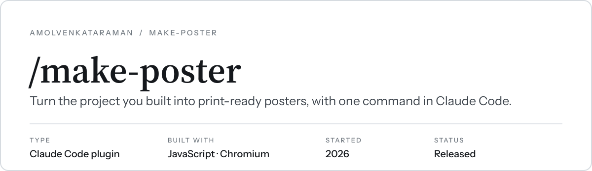
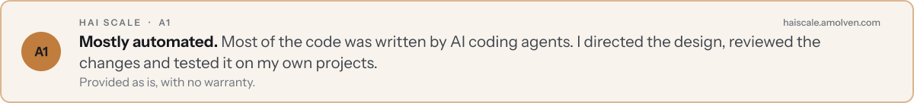
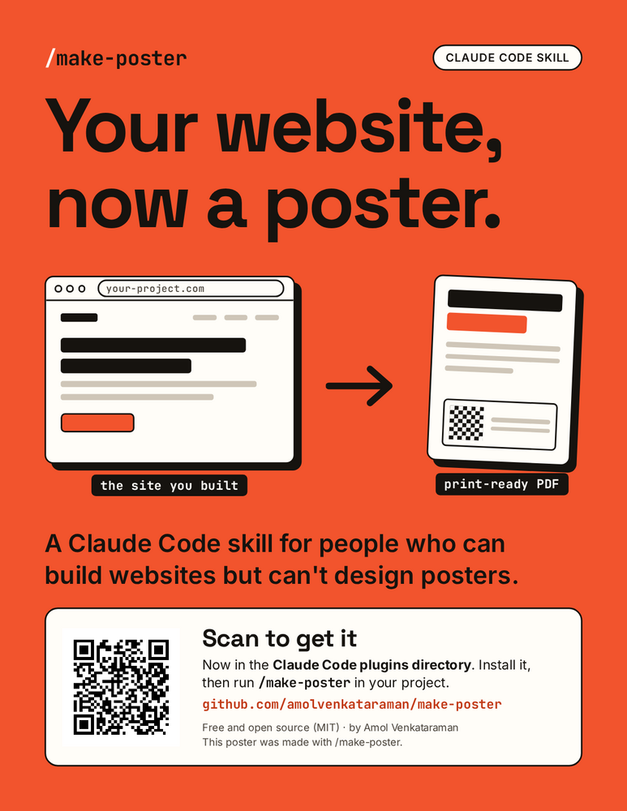
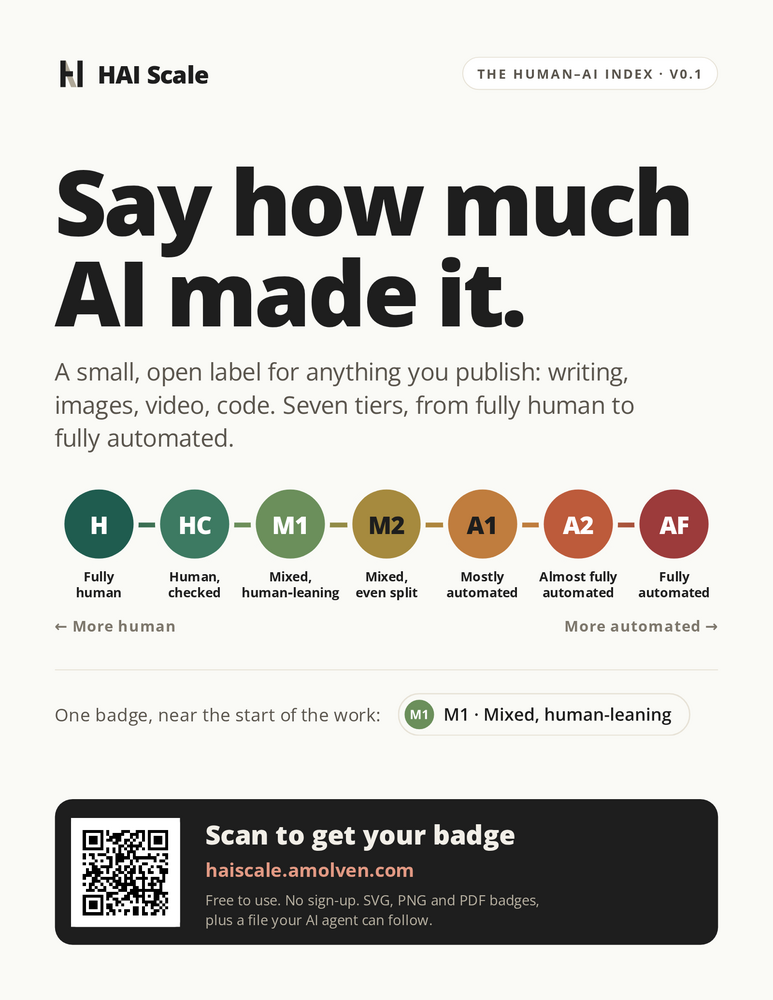
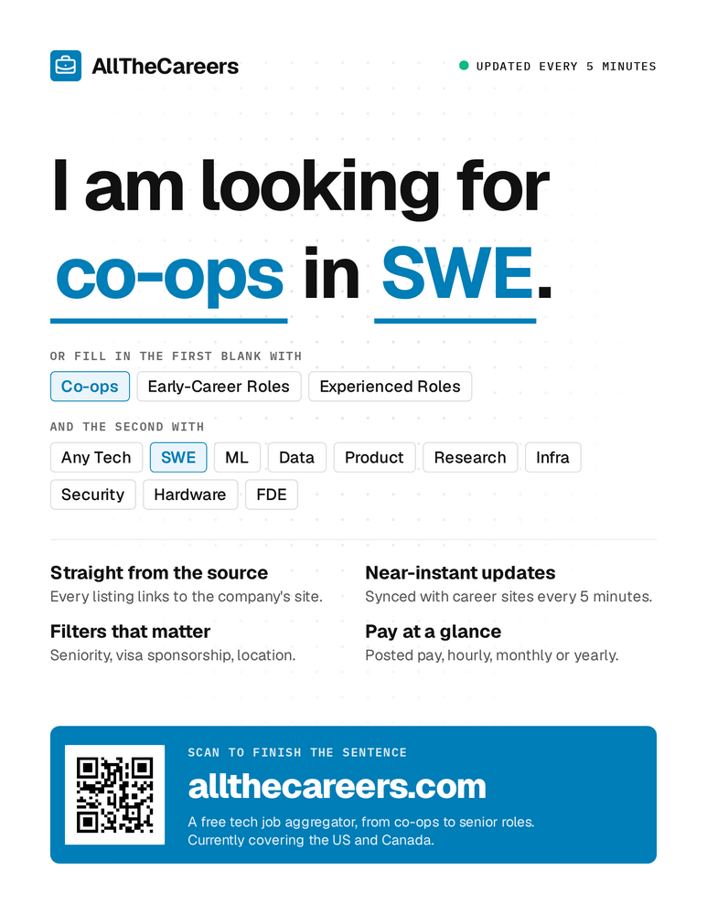
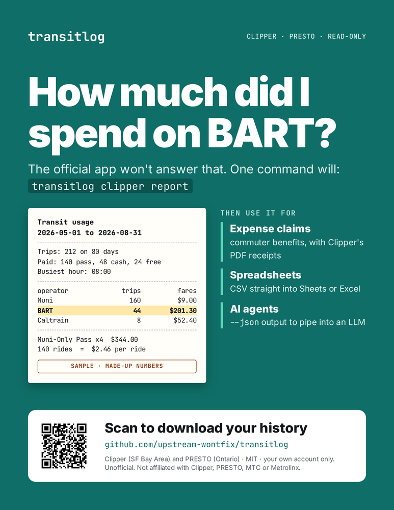
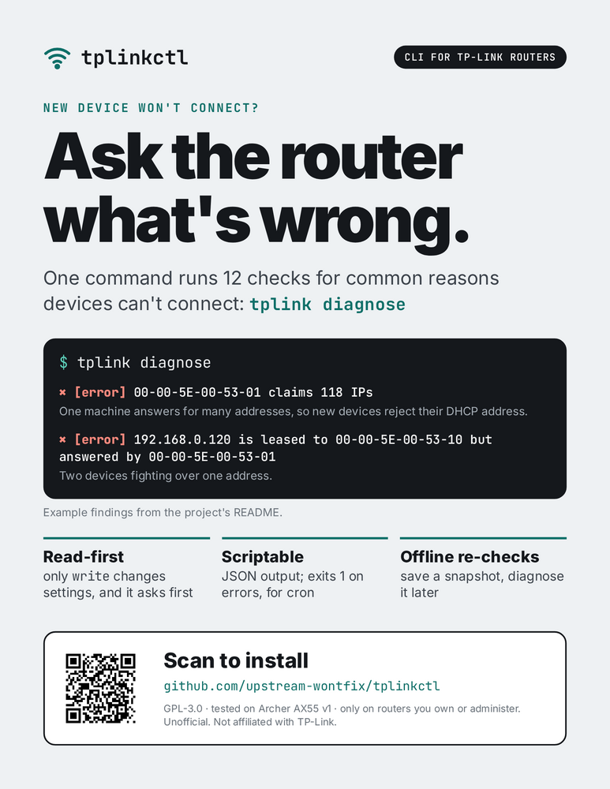

<!-- header:start -->
<div align="center">




[](LICENSE)

[How it works](#how-it-works) · [What you get](#what-you-get) · [Installation](#installation) · [Options](#options) · [Limitations](#limitations)

</div>

<a href="https://haiscale.amolven.com/A1/"></a>
<!-- header:end -->

`/make-poster` reads your codebase and your conversation with Claude to learn what
you built, asks a few questions about who the posters are for, then designs,
renders and reviews posters as PDFs sized exactly for the paper you'll print on.

## Gallery

Real output, one poster per project, each designed at US Letter from that project's
own README, code and brand. Click a poster for a larger version.

<table>
  <tr>
    <td align="center" valign="top" width="33%"><a href="docs/gallery/01-make-poster.png"></a><br><sub><b>make-poster</b>, this plugin</sub></td>
    <td align="center" valign="top" width="33%"><a href="docs/gallery/02-hai-scale.png"></a><br><sub><b><a href="https://haiscale.amolven.com">HAI Scale</a></b>, a label for disclosing AI use</sub></td>
    <td align="center" valign="top" width="33%"><a href="docs/gallery/03-allthecareers.png"></a><br><sub><b><a href="https://allthecareers.com">AllTheCareers</a></b>, a tech job board</sub></td>
  </tr>
  <tr>
    <td align="center" valign="top"><a href="docs/gallery/04-transitlog.png"></a><br><sub><b><a href="https://github.com/upstream-wontfix/transitlog">transitlog</a></b>, a transit-card history CLI</sub></td>
    <td align="center" valign="top"><a href="docs/gallery/05-tplinkctl.png"></a><br><sub><b><a href="https://github.com/upstream-wontfix/tplinkctl">tplinkctl</a></b>, a TP-Link router CLI</sub></td>
    <td></td>
  </tr>
</table>

## How it works

1. **Reads your project.** README, landing-page copy, changelog, recent commits,
   brand colors, fonts, logo, production URL, and real numbers worth printing.
   It also uses what you've built in the current Claude Code session.
2. **Asks you.** Who the audience is, paper size, how many designs, color and/or
   black-and-white, where they'll hang, where the QR code should point, and
   anything to include or leave out.
3. **Proposes concepts.** One distinct angle per design (a pain point, a big stat,
   a feature story…), not recolors of the same layout.
4. **Designs and renders.** Each design is built as HTML/CSS at the exact physical
   size and rendered to PDF with headless Chromium, with PNG previews.
5. **Reviews its own work.** Checks every design for overflow, safe margins, type
   size, contrast, QR code size, and claims it can't back up, then fixes and
   re-renders.
6. **Delivers.** One PDF per design and variant, a merged PDF for printing, previews,
   and print notes.

## What you get

- **Print-safe layouts**: content kept inside the margin home printers can reach,
  type sized for how far away people will read it.
- **Truthful copy**: every claim comes from your code, your copy or your conversation.
  No invented stats, testimonials or logos.
- **Monochrome versions designed for photocopiers**, not just filtered color.
- **QR codes** to your site, optionally with one UTM campaign per design so you can
  see which poster gets scanned.
- **Any size**: Letter, A4, Tabloid 11×17, A3, 18×24, A2, 24×36, A1, or custom;
  optional bleed for print shops.

## Installation

In Claude Code:

```
/plugin marketplace add amolvenkataraman/make-poster
/plugin install make-poster@make-poster
```

Then, in any project:

```
/make-poster
/make-poster --size tabloid --count 3 --color both
/make-poster for first-year students, 2 designs, black and white
```

**Requirements:** Node.js 20+. The first run asks before installing its rendering
runtime (Playwright's headless Chromium, a QR code library and pdf-lib, at pinned
versions, about 150 MB) into `~/.cache/make-poster`. Nothing is installed into your
project.

## Options

| Option | Values | Default |
|---|---|---|
| `--size` | `letter`, `a4`, `tabloid`, `a3`, `18x24`, `a2`, `24x36`, `a1`, or `WxH` with units (`11x17in`, `420x594mm`) | asked |
| `--orientation` | `portrait`, `landscape` | `portrait` |
| `--count` | 1–6 designs | asked |
| `--color` | `color`, `mono`, `both` | asked |
| `--audience` | free text | asked |
| `--out` | output folder | asked (suggests `~/Posters/<project>-<date>/`) |
| `--bleed` | adds 0.125 in bleed for print shops | off |

## What's inside

```
skills/make-poster/
  SKILL.md                    the workflow Claude follows
  references/design-guide.md  print rules: sizes, type minimums, QR codes, mono, review checklist
  runtime/                    the rendering runtime's pinned versions (package.json + lockfile)
  scripts/
    setup.sh                  one-time runtime install into ~/.cache/make-poster
    render.mjs                HTML → PDF at the exact @page size, plus PNG / grayscale previews
    check-fit.mjs             fails on content outside the safe margin, spilling out of its
                              box or overlapping; warns when a web font didn't load
    qr.mjs                    QR code as SVG
    qr-check.mjs              optional: decodes the QR codes in previews (needs OpenCV)
    pdf-info.mjs              page count and size of each PDF
    merge.mjs                 combines PDFs into one file for printing
tests/                        script tests and layout fixtures: node --test (after setup.sh)
```

## Limitations

- Built for Claude Code: it needs to run Node and a headless browser locally.
- It works best on projects with a public site to point people to, and with
  user-facing copy to draw from.
- Fonts come from the project or Google Fonts; fully offline rendering falls back to
  system fonts.
- It checks QR code size and placement, and can decode the codes from the previews
  when OpenCV is installed, but that isn't a phone scan of paper. Scan one printout
  before printing a stack.
- Posters are designed for readability and honesty over maximal flair; describe the
  vibe you want if you'd like something bolder.

## Version history

| Version | Changes |
|---|---|
| 1.0.0 | First release: context gathering, guided questions, multi-concept designs, color and designed mono variants, UTM-tracked QR codes, render + fit check + self-review loop. |

## License

[MIT](LICENSE) © 2026 Amol Venkataraman
